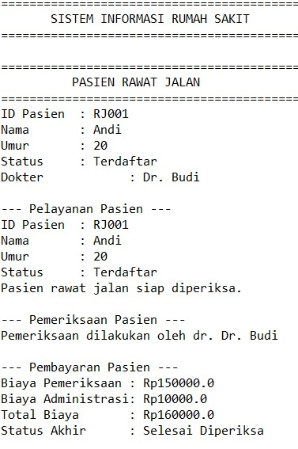
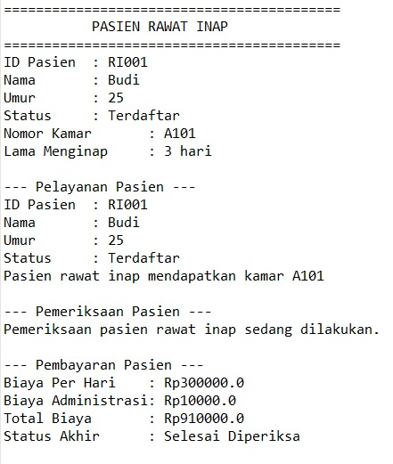
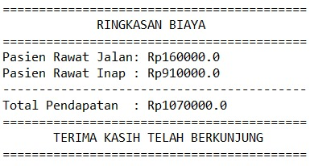

# Sistem Informasi Rumah Sakit

## 1. Identitas Mahasiswa

| Keterangan | Identitas |
|---|---|
| Nama | Nabil Wirman |
| NIM | H1D025076 |
| Program Studi | Informatika |
| Universitas | Universitas Jenderal Soedirman |
| Tema | Rumah Sakit |

Tema Rumah Sakit dipilih berdasarkan digit terakhir NIM, yaitu 6.

## 2. Deskripsi Program

Program ini merupakan aplikasi sederhana berbasis Java yang menerapkan konsep Pemrograman Berorientasi Objek (PBO) dengan tema Sistem Informasi Rumah Sakit.

Program memiliki dua jenis pasien, yaitu:

- **Pasien Rawat Jalan:** Pasien yang mendapatkan pelayanan pemeriksaan tanpa menginap di rumah sakit.
- **Pasien Rawat Inap:** Pasien yang mendapatkan pelayanan dengan menginap di rumah sakit.

Fitur program meliputi:
- Menampilkan informasi pasien.
- Melakukan pelayanan pasien.
- Melakukan pemeriksaan pasien.
- Menghitung biaya pemeriksaan dan administrasi.
- Menghitung biaya rawat inap berdasarkan lama menginap.
- Menampilkan ringkasan biaya pasien.

Program ini menerapkan konsep PBO, yaitu State and Behavior, Immutability, Encapsulation, Overloading, Inheritance, Super Chaining, Method Overriding, Abstract Class, Polymorphism, dan Multiple Interfaces.

## 3. Struktur Folder

```text
PBO_Responsi_RumahSakit/
│
├── README.md
│
├── PBO_Responsi_RumahSakit/
│   ├── Main.java
│   ├── Pasien.java
│   ├── PasienRawatJalan.java
│   ├── PasienRawatInap.java
│   ├── DapatDiperiksa.java
│   └── DapatDibayar.java
│
└── screenshots/
    └── hasil-program.png
```

## 4. Petunjuk Compile dan Run

Pastikan Java Development Kit (JDK) sudah terpasang pada komputer.

**Langkah 1 – Buka Terminal**

Buka terminal melalui VS Code atau Command Prompt, kemudian arahkan ke folder utama repositori.

**Langkah 2 – Compile Program**

Jalankan perintah berikut:

```bash
javac -d . PBO_Responsi_RumahSakit/*.java
```

Perintah tersebut digunakan untuk mengompilasi seluruh file Java yang terdapat di dalam folder program.

**Langkah 3 – Jalankan Program**

Setelah proses kompilasi berhasil, jalankan perintah:

```bash
java PBO_Responsi_RumahSakit.Main
```

Program akan menampilkan simulasi pelayanan pasien rawat jalan dan rawat inap beserta rincian biaya dan ringkasan pembayaran.

## 5. Screenshot Luaran Program

Berikut merupakan screenshot hasil eksekusi program melalui terminal.



